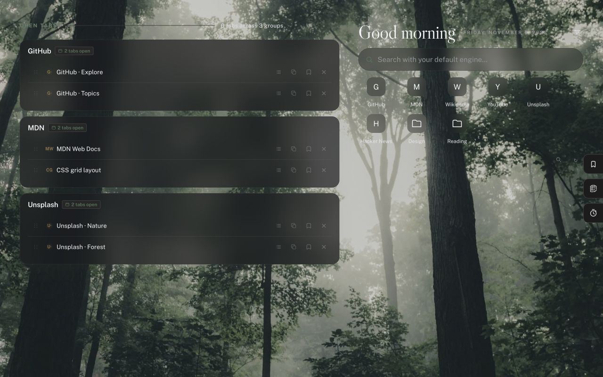
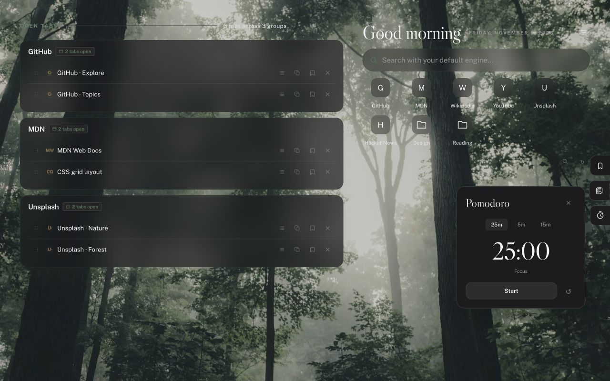

# astab

A clean new tab that stays out of your way. By [aste2d](https://github.com/aste2d/).

清爽的 Chrome 新标签页：左侧整理打开的标签页，右侧搜索和书签，旁边放好待办、笔记和番茄钟。主页没有品牌标识、广告或多余文案。



[下载最新版](https://github.com/aste2d/astab/releases/latest) · [反馈问题](https://github.com/aste2d/astab/issues) · [隐私政策](https://astab-privacy.poodle11215.chatgpt.site)

## 安装

需要 **Chrome 134 或更新版本**。目前通过 GitHub 分发，尚未上架 Chrome 应用商店。

1. 打开 [Releases](https://github.com/aste2d/astab/releases/latest)，下载附件 **`astab-版本号.zip`**。不需要安装 Node.js，也不需要编译。
2. 解压到一个准备长期保留的文件夹，例如文稿目录中的 `astab`。不要安装后移动或删除它。
3. 在 Chrome 地址栏输入 `chrome://extensions`，打开右上角的**开发者模式**。
4. 点击**加载已解压的扩展程序**，选择直接包含 `manifest.json` 的文件夹。
5. 新建标签页。如果 Chrome 询问是否保留新标签页更改，选择保留。

ZIP 用于解压安装；不要把 ZIP 或自行打包的 CRX 拖进扩展管理页当作商店安装包。下载 GitHub 自动生成的 Source code ZIP 也可以，但需要选择其中直接包含 `manifest.json` 的项目目录。

**默认行为：Auto close extras 已开启。** 打开一个新标签页时，会关闭所有窗口中其他的新标签页，包括固定的新标签页；普通网页保持打开。需要多个新标签页时，在右上角设置中关闭这个选项。

## 更新并保留设置

GitHub 手动安装版**不会自动更新**。

1. 从 [Releases](https://github.com/aste2d/astab/releases/latest) 下载新版本，先解压到临时文件夹。
2. 将新版本中的文件和子文件夹完整覆盖到**原来加载的同一个文件夹**。保留原文件夹路径，不要另选一个带新版本号的目录。
3. 打开 `chrome://extensions`，在现有的 astab 卡片上点击**重新加载**按钮。
4. 关闭旧的新标签页，重新打开一个新标签页，或刷新已打开的页面。在扩展详情中核对版本号。

**不要先删除／卸载 astab。** 同一路径下重新加载现有扩展可保留扩展身份及本地设置、待办、笔记和已保存页面；卸载会清除扩展的本地数据。Chrome 书签由浏览器单独管理。

已有本地开发版本的用户，应覆盖自己的原安装目录并重新加载，而不是再次“加载已解压的扩展程序”。将来切换到商店版可能会得到不同的扩展 ID，当前没有自动迁移本地数据的功能。

## 功能

- 标签页按网站分组；拖动卡片空白处或标题文字可自由排序，按钮和标签图标保留原有操作。每个标签页可单独复制标题。
- 书签保持 Chrome 原有顺序，支持文件夹、返回上级和全局搜索。`all bookmarks` 展示其余书签根目录的内容，不重复铺开书签栏。`Show All Bookmarks` 默认关闭，可在设置中打开，或通过悬停入口手动展开。
- 右侧提供稍后阅读、待办与笔记，以及可收起的番茄钟：25 分钟专注、5/15 分钟休息，支持暂停、继续和重置。
- 默认每日轮换八张精选 Unsplash 森林照片，也可手动换图、选择 Daily discovery 或使用自己的背景／纯色。离线时保留缓存或现有背景，没有图片时使用原来的纯色主题。
- 五种主题颜色可自选或随机生成；Default 恢复 Sage 配色。
- Close group 和 Close all tabs 在悬停时出现，需在五秒内再次点击确认；移出、按 Escape 或执行其他操作可取消。



## 隐私与权限

无需 astab 账号，无广告、分析追踪或开发者数据服务器。标签页、书签、保存的页面、笔记和计时状态在本地处理。在线壁纸会请求图片提供方；搜索使用 Chrome 的默认搜索引擎，打开链接会正常连接对应网站。

权限：`tabs` 展示和管理标签页；`bookmarks` 只读浏览书签；`storage` 保存本地数据；`search` 使用默认搜索引擎；`favicon` 显示网站图标；`alarms` 在页面关闭后结算计时器。

完整的数据处理、网络连接、保留和删除说明见[隐私政策](https://astab-privacy.poodle11215.chatgpt.site)。扩展内也可通过 About 阅读随包附带的政策。

## Install and update (English)

Requires Chrome 134+. Download `astab-VERSION.zip` from [Releases](https://github.com/aste2d/astab/releases/latest), extract it to a permanent folder, then open `chrome://extensions`, enable **Developer mode**, and select **Load unpacked**. Choose the folder containing `manifest.json`. No build step is needed.

For updates, replace the files in that **same folder**, then click **Reload** on the existing astab extension. Do not uninstall or load a different versioned folder: uninstalling removes local extension data, and changing the folder can change the extension identity. GitHub installations do not update automatically. A future store installation may have a different ID; automatic data migration is not currently implemented.

**Auto close extras is on by default:** a new tab closes every other new-tab page across windows, including pinned new tabs. Disable it in settings to keep multiple new tabs. Ordinary webpages stay open.

## Development

Vanilla JavaScript, HTML and CSS. No runtime packages or build dependencies. Use Node.js 22 or newer:

```sh
npm test
npm run icons
npm run package
```

The packaging script currently requires macOS or Linux with `/usr/bin/zip`. It writes `release/astab-VERSION.zip` using an explicit allowlist. Tests, screenshots and development files are excluded from the installable ZIP. Downloading a release does not require these development tools.

`dashboard-runtime.js` preserves the original layout; `tabs-panel.js` and `notes-panel.js` handle their respective views. `bookmarks.js`, `wallpaper.js` and `pomodoro.js` implement the additional features. `forest-library.js` records the photo sources and credits.

## Credits and license

Based on [Tab Harbor](https://github.com/V-IOLE-T/tab-harbor), copyright © 2026 Han Zheng, under the included [MIT license](LICENSE). Changes and branding by aste2d. Public Sans and Libre Caslon Display retain their bundled SIL Open Font Licenses. Forest photographs are credited in `forest-library.js`; optional Daily discovery uses [Lorem Picsum](https://picsum.photos/).

Bookmark navigation references the group-local folder interaction in [Bonjourr](https://github.com/victrme/Bonjourr/blob/master/src/scripts/features/links/folders.ts) and [Chromium’s bookmark guidance](https://www.chromium.org/user-experience/bookmarks/). No third-party source was copied for this feature.
